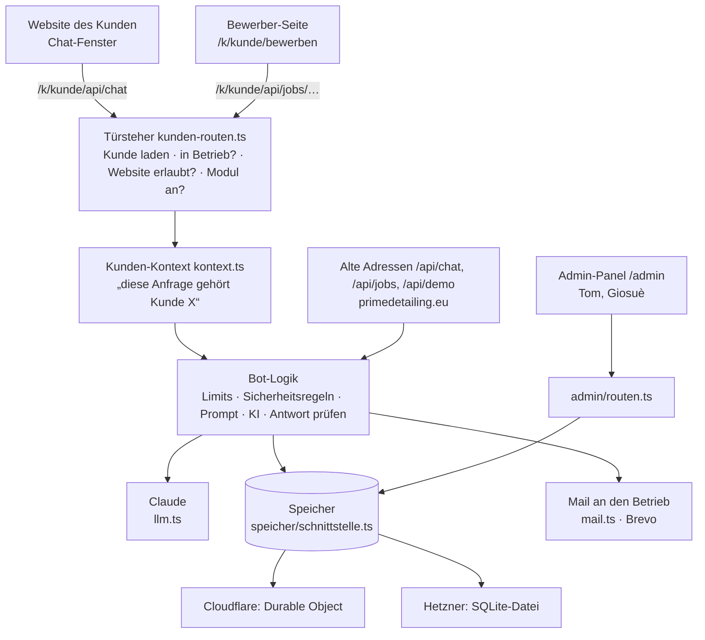

# Architektur: Kunden-Bots auf einen Blick

Ein Server, ein Code, viele Kunden. Alles, was von Kunde zu Kunde anders ist, steht in seiner **Kunden-Konfiguration** und wird im **Admin-Panel** gepflegt.

## Der Weg einer Chat-Nachricht

1. Das Chat-Fenster auf der Website von Maler Müller schickt die Nachricht an `/k/maler-mueller/api/chat`.
2. Der **Türsteher** (`kunden-routen.ts`) lädt die veröffentlichte Konfiguration von `maler-mueller`. Ist der Kunde pausiert, die Website nicht eingetragen oder das Modul aus, ist hier Schluss.
3. Die Anfrage läuft im **Kunden-Kontext** (`kontext.ts`). Ab jetzt meint `config` überall im Code die Konfiguration von Maler Müller.
4. **Limits** (`limits.ts`): pro Besucher und pro Kunde, dazu Tages- und Monatsbudget des Kunden.
5. **Feste Prüfungen vor der KI** (`guard.ts`): Umprogrammier-Versuche werden abgefangen.
6. Der **Prompt** entsteht aus der Vorlage (`prompt.ts`) und den Inhalten des Kunden. Preise stehen nie im Prompt, die KI holt sie über Werkzeuge (`tools.ts`).
7. **Feste Prüfungen nach der KI**: Jeder Satz wird geprüft (erfundene Beträge, Zusagen, Rabatte), bevor der Besucher ihn sieht. Diese Regeln stehen im Code, die KI kann sie nicht überstimmen.
8. Eine abgeschickte Anfrage wird beim Kunden **gespeichert** und per **Mail** an den Betrieb geschickt.

## Wo liegt was (Ordner `chatbot/src/`)

| Datei / Ordner | Inhalt |
|---|---|
| `kontext.ts` | Kunden-Kontext: Welcher Kunde ist bei dieser Anfrage dran? |
| `kunde/schema.ts` | **Alle Felder der Kunden-Konfiguration** mit Erklärung und Prüfregeln |
| `kunde/vorlagen.ts` | Die 22 Branchen-Vorlagen |
| `kunde/umwandeln.ts` | Übersetzt die Konfiguration in das, was die einzelnen Bots brauchen |
| `kunden-routen.ts` | Alle Adressen unter `/k/<kunde>/…` |
| `kunden-termin.ts` | Termin-Bot und Anfrage-Chat je Kunde (`/k/<kunde>/termin`, `/k/<kunde>/anfrage`) |
| `seiten/` | Die Seiten eines Kunden: Bewerben, Termin, Anfrage, kleine Startseite |
| `speicher/` | Speicher-Schnittstelle, SQL-Befehle, je eine dünne Schicht für Cloudflare und Node |
| `zugang/` | Kunden-Zugang `/k/<kunde>/verwalten`: Anmeldung, freigegebene Felder, Oberfläche (siehe `KUNDEN-ZUGANG.md`) |
| `sicherheit.ts` | Gemeinsamer Schutz: Codes, Sitzungs-Cookies, Herkunftsprüfung, Antwort-Köpfe (siehe `SICHERHEIT.md`) |
| `admin/` | Admin-Panel: Anmeldung, Schnittstellen, Einrichtungs-Check, Oberfläche (`seite.html`) |
| `app.ts`, `llm.ts`, `prompt.ts`, `tools.ts`, `guard.ts`, `limits.ts`, `foto.ts` | Kunden-Chat (für alle Kunden gleich) |
| `bewerber.ts`, `jobs.ts` | Bewerber-Chat |
| `demo.ts`, `betrieb.ts`, `termin.ts` | Vorführseiten auf primedetailing.eu/demo (unverändert) |
| `anruf.ts`, `stimme.ts`, `kontakt.ts`, `crm/` | Anruf-Retter, Telefon-Bot, Kontaktformular, internes CRM (nicht Teil des Umbaus) |
| `config/bot.config.json`, `data/wissen.md` | Prime Detailing (Kunde 1) und die Modell-Einstellungen für alle |

## Was die KI darf und was nicht

| Bot | Rolle der KI | Feste Grenzen im Code |
|---|---|---|
| Kunden-Chat | beantwortet Fragen, empfiehlt Leistungen | Preise nur aus der Preisliste, keine Zusagen, keine Rabatte, jeder Satz wird geprüft |
| Bewerber-Chat | beantwortet Fragen zu Stellen | bewertet niemanden, sieht weder Angaben noch Unterlagen, keine Gehaltszahlen |
| Termin-Bot | keine | freie Zeiten, Puffer und Buchung rechnet nur der Code |
| Anfrage-Chat | sortiert nach Dringlichkeit vor | Sicherheitsregeln aus der Konfiguration gelten immer; die KI kann nur höher einstufen, nie niedriger |

## Entwurf und veröffentlicht

Speichern im Admin-Panel ändert nur den **Entwurf**. Die Bots beim Kunden benutzen immer die zuletzt **veröffentlichte** Fassung. So kann man in Ruhe ändern und unter „Testen“ ausprobieren. Jede Veröffentlichung landet im Verlauf und lässt sich zurückholen.

## Prime Detailing (Kunde 1)

Prime Detailing läuft weiter über die alten Adressen (`/api/chat`, `/api/jobs/…`) und wird wie bisher gepflegt: Preise und Stellen im Website-CMS, der Rest in `config/bot.config.json` und `data/wissen.md`. Technisch ist es der „Standard-Kunde“ mit der ID `prime-detailing` im selben Kunden-Kontext wie alle anderen. Auf primedetailing.eu musste nichts geändert werden.

## Glossar

| Begriff | Bedeutung |
|---|---|
| **Mandant / Kunde** | Ein Betrieb, der unsere Bots nutzt. „Mandantenfähig“ heißt: Ein Server bedient viele Kunden, jeder sieht nur seins. |
| **Kunden-ID (Slug)** | Kurzname in Kleinbuchstaben, z. B. `maler-mueller`. Steht in allen Links des Kunden. |
| **Entwurf / veröffentlicht** | Gespeicherte, aber noch nicht live geschaltete Fassung / die Fassung, die die Bots benutzen. |
| **Widget** | Das Chat-Fenster, das per `<script>`-Zeile auf der Website des Kunden erscheint. |
| **Durable Object** | Kleine Datenbank bei Cloudflare, die zu unserem Worker gehört. |
| **SQLite** | Datenbank in einer einzigen Datei. Auf Hetzner liegen dort alle Kundendaten. |
| **CORS / erlaubte Website** | Regel im Browser: Nur eingetragene Websites dürfen die Bots eines Kunden aufrufen. |
| **Secret** | Geheimer Schlüssel (z. B. für die KI). Steht nie im Code, nur am Server. |
| **Service-Account (Dienstkonto)** | Technisches Google-Konto für den Kalender-Zugriff des Termin-Bots. |
| **Webhook** | Adresse, die ein fremder Dienst aufruft, wenn etwas passiert (z. B. sipgate bei einem Anruf). |
| **Prompt** | Die Anweisungen, die die KI vor jedem Gespräch bekommt. |
